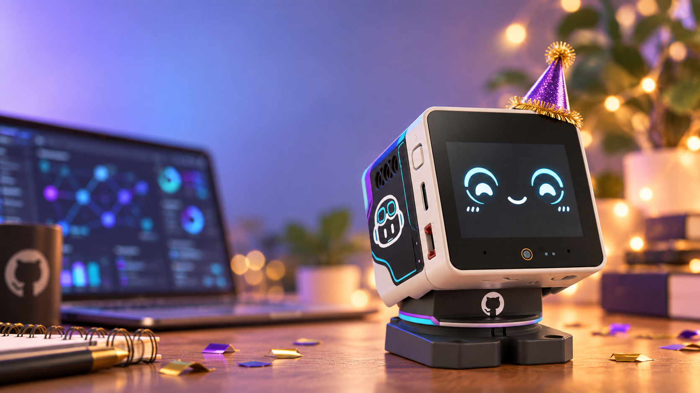

# New Year, New Bot 🤖

**Tiny robot. Big plans for 2027.**

**Explore the series and proposed architecture:** [Project page](https://aka.ms/newyearnewbot) ([direct link](https://elbruno.github.io/new-year-new-bot/))



> **Concept art:** This illustration communicates the project's creative direction. It is not a photograph of a working prototype, and the GitHub-inspired details are not an approved or manufactured accessory.

## .NET Conf 2026 session

In **[Give Your .NET Agent a Face: Building an AI Desk Companion with M5Stack](https://dotnet.microsoft.com/en-us/conf/2026/agenda/brk040)**, Bruno Capuano demonstrates an M5Stack/StackChan desk companion connected to a .NET 11 backend, with Aspire, Microsoft Foundry, Microsoft Agent Framework, and GitHub Copilot SDK. The session covers the architecture, a live interaction, and safe use of work context.

Watch the session on [YouTube](https://www.youtube.com/watch?v=7EXrTrcJ7zA).

Presentation slides (v07): [Download the PDF](sessions/26-11-dotnetconf/Give-Your-DotNet-Agent-a-Face-v07.pdf).

## Code samples

[Which device is on this COM port?](tools/serial-ports/README.md) is a standalone
.NET 10 file-based C# console app for Windows. Inspect USB device metadata,
watch unplug/replug events, or export JSON without opening a serial port or
changing firmware. Includes synthetic self-tests that need no hardware.

```powershell
Set-Location tools\serial-ports
dotnet run SerialPorts.cs
dotnet run SerialPorts.cs -- --watch
dotnet run SerialPorts.cs -- --self-test
```

Install a stable .NET 10 SDK first. Read the sample's privacy guidance before
sharing terminal output or recording a demo.

## Coming soon

We’re building a fun AI desk companion with the M5Stack StackChan and exploring how it can connect to .NET services and AI technologies.

Follow along as we share the project, demos, and getting-started resources. More details are coming soon!

**Project hub:** [aka.ms/newyearnewbot](https://aka.ms/newyearnewbot)

---

*A community project in progress. Hardware, software, schedule, and stream details will be shared as they’re confirmed.*
