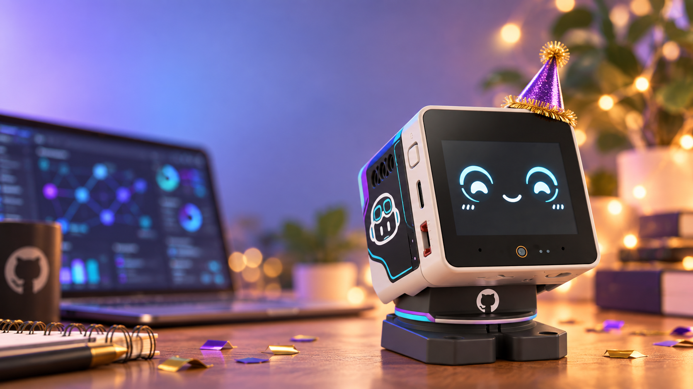

# New Year, New Bot 🤖

**Tiny robot. Big plans for 2027.**

**[Get the robot](https://aka.ms/newyearnewbot/robot?utm_source=new_year_new_bot&utm_medium=referral&utm_campaign=series_2026&utm_content=robot)**

**Explore the series and proposed architecture:** [Project page](https://aka.ms/newyearnewbot) ([direct link](https://elbruno.github.io/new-year-new-bot/))



> **Concept art:** This illustration communicates the project's creative direction. It is not a photograph of a working prototype, and the GitHub-inspired details are not an approved or manufactured accessory.

## .NET Conf 2026 session

In **[Give Your .NET Agent a Face: Building an AI Desk Companion with M5Stack](https://dotnet.microsoft.com/en-us/conf/2026/agenda/brk040)**, Bruno Capuano demonstrates an M5Stack/StackChan desk companion connected to a .NET 11 backend, with Aspire, Microsoft Foundry, Microsoft Agent Framework, and GitHub Copilot SDK. The session covers the architecture, a live interaction, and safe use of work context.

Watch the session on [YouTube](https://www.youtube.com/watch?v=7EXrTrcJ7zA).

Presentation slides (v07): [Download the PDF](sessions/26-11-dotnetconf/Give-Your-DotNet-Agent-a-Face-v07.pdf).

## Code samples

[Which device is on this COM port?](src/serial-ports/README.md) is a standalone
.NET 10 file-based C# console app for Windows. Inspect USB device metadata,
watch unplug/replug events, or export JSON without opening a serial port or
changing firmware. Includes synthetic self-tests that need no hardware.

```powershell
Set-Location src\serial-ports
dotnet run SerialPorts.cs
dotnet run SerialPorts.cs -- --watch
dotnet run SerialPorts.cs -- --self-test
```

Install a stable .NET 10 SDK first. Read the sample's privacy guidance before
sharing terminal output or recording a demo.

## New Year, New Bot - Episode 1

- [Episode 1 resources](episodes/episode-1/README.md)
- [Firmware 0.5.1 source](src/firmware/usb-avatar/)
- [C# robot client library](src/RobotClient/StackChan.RobotClient/)
- [C# console application](src/RobotClient/StackChan.ConsoleDemo/)
- [Official New Year, New Bot series website](https://elbruno.github.io/new-year-new-bot/)

Episode 1, **Bring Your AI Desk Robot to Life**, took place on November 24,
2026. Watch the [.NET livestream](https://www.youtube.com/watch?v=9pk9HERln5k)
or the [Microsoft Reactor livestream](https://www.youtube.com/watch?v=L-zaWiyjDEU).
The episode resource page links to the source projects, build instructions, and
official device and .NET documentation.

Next up: [Episode 2, Build Its AI Brain with .NET and Aspire](https://developer.microsoft.com/en-us/reactor/events/27762/),
on December 1, 2026 at 10:00 AM PST / 1:00 PM EST / 6:00 PM UTC.

**Project hub:** [aka.ms/newyearnewbot](https://aka.ms/newyearnewbot)

## Source file headers

First-party source files must have a short English header describing their
Goal, Responsibilities, and How it works, using the language's native comment
syntax. Add headers to new files and maintain them when responsibilities change;
keep them accurate and concise, and preserve existing license notices and
required compiler directives. Generated and third-party code is excluded.

## Firmware API documentation

When the firmware HTTP API changes, update the
[API reference](docs/api/firmware-http-api.md) alongside it. Keep routes,
request and response contracts, examples, errors, and build availability
aligned with the implementation, and publish the reference together with
the corresponding firmware changes. Unrelated code changes need no API update.

---

*A community project in progress. Hardware, software, schedule, and stream details will be shared as they’re confirmed.*
