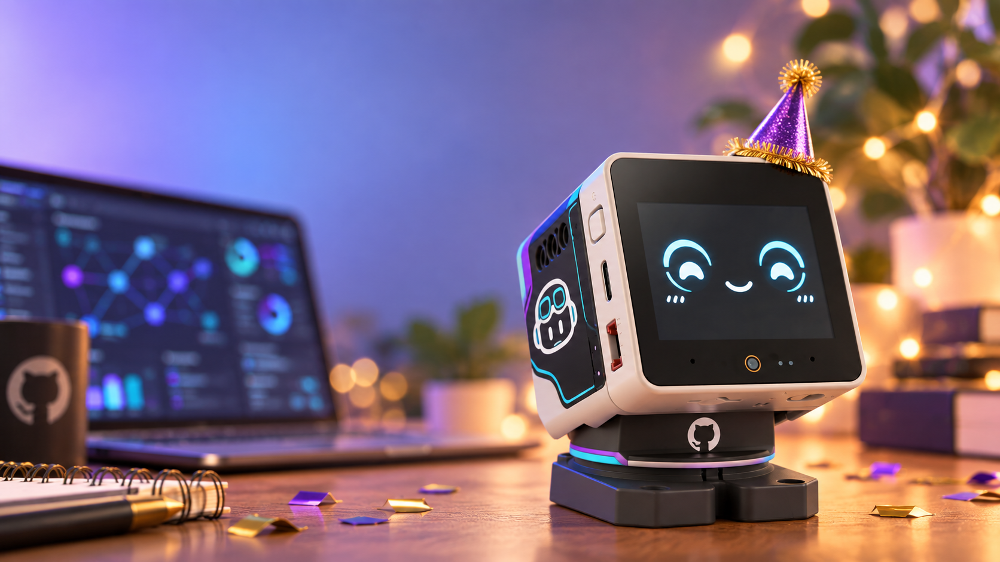

# New Year, New Bot 🤖

**Tiny robot. Big plans for 2027.**

**Explore the series and proposed architecture:** [Project page](https://elbruno.github.io/new-year-new-bot/)

> **Concept art:** This illustration communicates the project's creative direction. It is not a photograph of a working prototype, and the GitHub-inspired details are not an approved or manufactured accessory.

## Coming soon

We’re building a fun AI desk companion with the M5Stack StackChan and exploring how it can connect to .NET services and AI technologies.

Follow along as we share the project, demos, and getting-started resources. More details are coming soon!

**Project hub:** [aka.ms/newyearnewbot](https://aka.ms/newyearnewbot)

---

*A community project in progress. Hardware, software, schedule, and stream details will be shared as they’re confirmed.*
