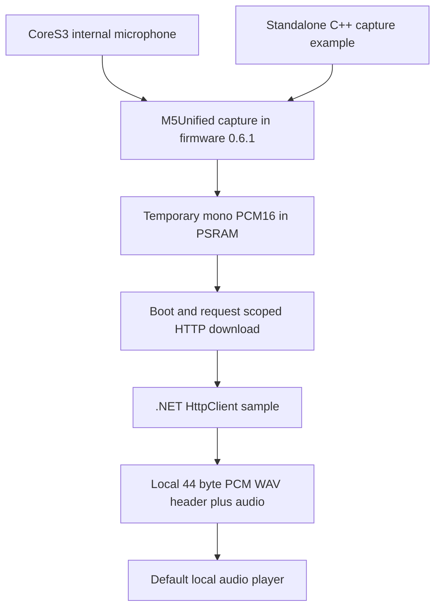

# StackChan microphone capture samples

These samples demonstrate a short CoreS3 microphone capture and a .NET client
that downloads the matching PCM data from an existing StackChan. The C++ sketch
is a standalone local capture example; it does not install the Wi-Fi firmware
or add HTTP routes.

## Architecture



The standalone sketch and the firmware API are separate examples of the same
capture path. The sketch records to PSRAM and reports completion over serial.
The .NET program communicates with a StackChan already running compatible
firmware.

## Requirements and compatibility

- M5Stack CoreS3 with its internal microphone and PSRAM. The sketch targets
  CoreS3, not CoreS3 SE.
- A StackChan running firmware **0.6.1 or later** with the Wi-Fi lab profile
  and Extended microphone routes for the .NET sample.
- PlatformIO Core and the pinned Espressif32 8.0.0, M5Unified 0.2.27, and
  M5GFX 0.2.34 dependencies for the C++ sketch.
- .NET 11 SDK for the C# sample.

The public firmware source bundle remains a 0.5.1 draft snapshot. It does not
contain the 0.6.1 microphone firmware implementation. These examples target
the separately validated 0.6.1 HTTP contract; they do not upgrade or flash
the firmware for you.

## C++ capture example

Source: [main.cpp](../firmware/microphone-capture/src/main.cpp),
[PlatformIO configuration](../firmware/microphone-capture/platformio.ini), and
[pinned M5Unified microphone patch](../firmware/microphone-capture/patch_m5unified_microphone.py).

Build from the repository root:

```powershell
Set-Location .\src\firmware\microphone-capture
pio run
```

To run this standalone sketch, upload it to a CoreS3 and read its serial output:

```powershell
pio run -t upload
pio device monitor -b 115200
```

Uploading a standalone sketch replaces the currently installed firmware.
The sketch checks the CoreS3 microphone pin configuration, refuses to capture
while audio is busy, pauses an idle speaker when needed, captures three seconds
at 16 kHz, and resumes the speaker after confirmed microphone cleanup.

The maximum recording is 48,000 signed PCM16 samples, or 96,000 bytes. It
allocates that buffer with
`heap_caps_malloc(bytes, MALLOC_CAP_SPIRAM | MALLOC_CAP_8BIT)`. The recording
is temporary and is never written to the robot's microSD card. If microphone
or codec cleanup is uncertain, the example intentionally retains the buffer
until reboot instead of freeing memory that might still be in use.

The capture completion callback is part of M5Unified 0.2.27. The example also
uses the same small, exact-match patch required by the validated firmware to
expose CoreS3 codec I2C initialization and cleanup failures. PlatformIO applies
the patch to its pinned dependency and fails if the expected source does not
match; it is not an unpatched-upstream-only sketch.

## .NET download and playback

Source: [Program.cs](../RobotClient/MicrophoneCaptureDemo/Program.cs),
[MicrophoneWav.cs](../RobotClient/MicrophoneCaptureDemo/MicrophoneWav.cs), and
[project file](../RobotClient/MicrophoneCaptureDemo/MicrophoneCaptureDemo.csproj).

Run from the repository root, replacing the example address with the robot's
HTTP origin on your trusted LAN:

```powershell
dotnet run --project .\src\RobotClient\MicrophoneCaptureDemo -- "http://<robot-address>"
```

The program checks `/api/version` and the microphone status route, starts a
three-second capture, polls its boot/request-scoped state, validates the raw
PCM response and identity headers, writes a WAV file, releases the file stream,
then asks the operating system to open it with the default audio player. It
uses only the .NET framework libraries and `HttpClient`.

The capture is mono, signed PCM16 little-endian at 16 kHz. A full capture is
96,000 PCM bytes; the standard 44-byte PCM WAV header makes the saved file
96,044 bytes. The buffer remains temporary in robot PSRAM until the HTTP
transfer completes. `GET /api/microphone/capture` reports
`downloadAvailable`; the download URL must include both `bootId` and
`requestId`. The full request and response contract is in the
[firmware API reference](../../docs/api/firmware-http-api.md#microphone-capture).

The microphone and speaker share audio resources, so capture is half-duplex.
This sample does not stream audio, store it on the robot, transcribe it, or
send it to a cloud service. The robot API is unauthenticated: use it only on a
trusted, isolated local network, never expose it to the Internet, and do not
share the robot address or terminal output.

Run the C# sample's offline checks without connecting to a robot:

```powershell
dotnet run --project .\src\RobotClient\MicrophoneCaptureDemo -- --self-test
```

## Troubleshooting

- **404 or `microphone_unavailable`:** use firmware 0.6.1+ with the Wi-Fi lab
  Extended profile and a supported CoreS3 microphone.
- **`audio_busy`:** stop speaker playback or another audio operation, then run
  a new capture after checking the current status. Do not replay an uncertain
  POST automatically.
- **PSRAM allocation failure:** confirm the target is a CoreS3 with working
  PSRAM and enough free memory.
- **Download identity or length mismatch:** keep the `bootId` and `requestId`
  returned by the same capture. A reboot or mismatched request invalidates that
  download.
- **WAV file is saved but does not open:** open the printed `.wav` path with a
  local player that supports PCM WAV. The example does not install a player.

## References

- [M5Stack CoreS3 microphone](https://docs.m5stack.com/en/arduino/m5cores3/mic)
- [M5Unified 0.2.27 microphone API](https://github.com/m5stack/M5Unified/blob/0.2.27/src/utility/Mic_Class.hpp)
- [M5Unified 0.2.27 speaker API](https://github.com/m5stack/M5Unified/blob/0.2.27/src/utility/Speaker_Class.hpp)
- [New Year, New Bot series](https://elbruno.github.io/new-year-new-bot/)
- [Public repository](https://github.com/elbruno/new-year-new-bot)
